# 🚀 ROADMAP v0.9.0: "EL SALTO GENERACIONAL Y MAGIA NEGRA"
## *Arquitectura JIT Tier-2, AMD FidelityFX FSR, Blindaje 60 FPS Mali/Infinix, UI Glassmorphism y Ecosistema Táctico*

> [!NOTE]
> **Principio Fundamental de v0.9.0:** Todo cambio que altere la estética visual, la respuesta de los controles, la jugabilidad o el comportamiento original del juego se implementa como **INTERRUPTOR OPCIONAL EN LOS AJUSTES**. El jugador conserva el control total y absoluto para activar o desactivar cada brujería técnica de manera independiente.

---

## 📑 ÍNDICE GENERAL DEL ROADMAP v0.9.0

1. [Visión y Objetivos Cuantitativos de la Versión 0.9.0](#1-visión-y-objetivos-cuantitativos-de-la-versión-090)
2. [🔥 Bloque I: Plan Maestro "60 FPS Fijos en Combate" (Especial Mali / MediaTek / Infinix)](#2-🔥-bloque-i-plan-maestro-60-fps-fijos-en-combate)
   - [1.1 Desactivación de Overdraw en Mali (Alpha-Test Early-Z & Discard FPK)](#11-desactivación-de-overdraw-en-mali)
   - [1.2 Despertador de Frecuencia GPU (Bypass de Downclocking en MediaTek Mali)](#12-despertador-de-frecuencia-gpu)
   - [1.3 Tablas de Búsqueda Rápida (LUT AOT) para Trigonometría y Proyectiles](#13-tablas-de-búsqueda-rápida-lut-aot)
   - [1.4 Memoización de Fórmulas de Daño y Estadísticas en Batalla](#14-memoización-de-fórmulas-de-daño-y-estadísticas)
   - [1.5 Modo Rendimiento "Combate Extremo" (Perfil de 1 Toque para Gamas Media/Baja)](#15-modo-rendimiento-combate-extremo)
3. [🧙‍♂️ Bloque II: Pipeline Gráfico de Vanguardia y AMD FidelityFX FSR](#3-🧙‍♂️-bloque-ii-pipeline-gráfico-de-vanguardia-y-amd-fidelityfx-fsr)
   - [2.1 AMD FidelityFX FSR 1.0 (EASU + RCAS en Compute Shaders)](#21-amd-fidelityfx-fsr-10)
   - [2.2 Super-Resolución Neuronal xBRZ 4x/6x HD para Pixel-Art Vectorial](#22-super-resolución-neuronal-xbrz)
   - [2.3 Escalado Dinámico de Resolución con Bucle PID Continuo (DRS Automático)](#23-escalado-dinámico-de-resolución-con-bucle-pid)
   - [2.4 Mega-Atlas Virtual y Fusión Zero-Draw-Call (1 a 3 llamadas por cuadro)](#24-mega-atlas-virtual-y-fusión-zero-draw-call)
   - [2.5 Tasa de Refresco Adaptativa para Pantallas LTPO / VRR (10 Hz a 120 Hz)](#25-tasa-de-refresco-adaptativa-para-pantallas-ltpo)
4. [⚡ Bloque III: Motor de Ejecución de Bajo Nivel y CPU](#4-⚡-bloque-iii-motor-de-ejecución-de-bajo-nivel-y-cpu)
   - [3.1 Compilador JIT Tier-2 Nativo (Bytecode GML a ARM64 AArch64 en Memoria)](#31-compilador-jit-tier-2-nativo)
   - [3.2 Afinidad de Hilos CPU y Planificador Big.LITTLE (`sched_setaffinity`)](#32-afinidad-de-hilos-cpu-y-planificador-biglittle)
   - [3.3 Particionado de Instancias Activas vs Estáticas en el Bucle Step](#33-particionado-de-instancias-activas-vs-estáticas)
   - [3.4 Mapeo de Memoria Directo Virtual con `mmap` para Assets (Zero-Heap Copy)](#34-mapeo-de-memoria-directo-virtual-con-mmap)
5. [🎮 Bloque IV: Movilidad, Ergonomía y Controles de Nueva Generación](#5-🎮-bloque-iv-movilidad-ergonomía-y-controles-de-nueva-generación)
   - [4.1 D-Pad Táctil Fantasma Dinámico (*Floating Dynamic Center*)](#41-d-pad-táctil-fantasma-dinámico)
   - [4.2 Rueda Táctica Radial de Combate (Estilo Doom / GTA con Time-Dilation 0.2x)](#42-rueda-táctica-radial-de-combate)
   - [4.3 Gestos Multi-Touch Inteligentes (Pellizco, Deslizamiento Triple y Turbo)](#43-gestos-multi-touch-inteligentes)
   - [4.4 Disposición Ergonómica de Combate a Una Mano (Arco para Pulgar)](#44-disposición-ergonómica-de-combate-a-una-mano)
   - [4.5 Pre-renderizado de Capa Estática del HUD en FBO](#45-pre-renderizado-de-capa-estática-del-hud-en-fbo)
   - [4.6 Soporte de Mandos Físicos Pro con Háptica HD Dual Independiente](#46-soporte-de-mandos-físicos-pro-con-háptica-hd-dual)
6. [✨ Bloque V: Brujerías Audiovisuales y de Simulación](#6-✨-bloque-v-brujerías-audiovisuales-y-de-simulación)
   - [5.1 Iluminación 2D Dinámica y Sombras Proyectadas por Ataques (Deferred GLSL)](#51-iluminación-2d-dinámica-y-sombras-proyectadas)
   - [5.2 Audio Espacial 3D Binaural (HRTF) y Stems Reactivos de Batalla](#52-audio-espacial-3d-binaural-hrtf)
   - [5.3 Resampler Armónico WSOLA para Modo Turbo (Audio con Tono Preservado)](#53-resampler-armónico-wsola-para-modo-turbo)
   - [5.4 Smart Pre-Roll Skip (Supresión de Animaciones Repetitivas de Entrada)](#54-smart-pre-roll-skip)
   - [5.5 Caja Negra de Repetición Determinista (Replay Recorder de < 30 KB)](#55-caja-negra-de-repetición-determinista)
   - [5.6 Filtros de Accesibilidad de Daltonismo en GPU (Deuteranopía / Protanopía)](#56-filtros-de-accesibilidad-de-daltonismo)
7. [📱 Bloque VI: Interfaz del Emulador "AAA" y Sistema Operativo](#7-📱-bloque-vi-interfaz-del-emulador-aaa-y-sistema-operativo)
   - [6.1 Interfaz Glassmorphism con Blur Gaussiano en Vivo y Material You](#61-interfaz-glassmorphism)
   - [6.2 Carrusel Deslizante de Guardados Rápidos (Save States) con Miniaturas WebP](#62-carrusel-deslizante-de-guardados-rápidos)
   - [6.3 Widget Flotante de Pokédex y Análisis de Debilidades en Tiempo Real](#63-widget-flotante-de-pokédex-y-debilidades)
   - [6.4 Modo Ventana Flotante / Picture-in-Picture (PiP) para Farmeo](#64-modo-ventana-flotante-pip)
   - [6.5 Notificación Viva / Live Activity en Barra de Estado (Android 14/15/16)](#65-notificación-viva-live-activity)
8. [🏆 Bloque VII: Sistema de Logros y Progresión](#8-🏆-bloque-vii-sistema-de-logros-y-progresión)
   - [7.1 Sistema de Logros Retro Integrado con Banners Emergentes Animados](#71-sistema-de-logros-retro-integrado)
9. [🗺️ Matriz de Opciones y Configuración en Ajustes](#9-🗺️-matriz-de-opciones-y-configuración-en-ajustes)
10. [📅 Plan de Ejecución por Fases (Fase 1 a Fase 4)](#10-📅-plan-de-ejecución-por-fases)

---

## 1. Visión y Objetivos Cuantitativos de la Versión 0.9.0

| Subsistema / Métrica | Estado Actual (v0.8.8 EX en Infinix) | Meta Cuantitativa v0.9.0 |
| :--- | :--- | :--- |
| **FPS en Sobremundo (Exterior)** | ~55 FPS con micro-oscilaciones | **60 FPS clavados y planos (16.66 ms)** |
| **FPS en Combates (Batallas)** | 30 FPS – 35 FPS (caída severa) | **60 FPS estables sin tirones** |
| **Uso de Ancho de Banda GPU Mali** | Saturación por sobregiro (Overdraw TBDR) | **-45% de carga con Alpha-Test Early-Z FPK** |
| **Frecuencia GPU en MediaTek** | Downclocking a 250-300 MHz en 2D | **Reloj activo forzado a 800-950 MHz** |
| **Calidad de Reescalado Móvil** | Bilineal estándar o FBO nativo | **AMD FSR 1.0 (EASU + RCAS) de grado consola** |
| **Cambios y Objetos en Batalla** | Pausa lenta en mochila | **Rueda radial táctica instantánea (< 1 ms)** |
| **Tirón al cruzarse con NPC / Rutas** | Bucle lineal de instancias estáticas | **Partición activa/estática (-4 ms de CPU)** |

---

## 2. 🔥 Bloque I: Plan Maestro "60 FPS Fijos en Combate" (Especial Mali / MediaTek / Infinix)

> [!IMPORTANT]
> **Diagnóstico del problema en el Infinix:** Los procesadores MediaTek Helio (G85, G88, G96, G99) incorporan GPUs ARM Mali con arquitectura TBDR (*Tile-Based Deferred Rendering*). En combate, la combinación de fondo de arena + Pokémon + sombras + proyectiles transparentes + barras de vida genera una **saturación masiva de sobregiro (*overdraw*)**, mientras que el gobernador térmico de MediaTek baja el reloj de la GPU a 300 MHz creyendo que es una escena 2D estática.

### 1.1 Desactivación de Overdraw en Mali (Alpha-Test Early-Z & Discard FPK)
* **El Problema:** La GPU Mali evalúa y mezcla múltiples capas de píxeles transparentes superpuestos en cada tile de memoria local.
* **La Solución:** 
  1. Renderizar primero el suelo de la arena de combate con mezcla desactivada (`glDisable(GL_BLEND)`).
  2. Para sprites y proyectiles con canal alfa, inyectar la instrucción `if (texColor.a < 0.05) discard;` en el fragment shader.
* **Impacto:** Activa la tecnología de hardware *Forward Pixel Kill* (FPK) nativa de Mali, descartando píxeles invisibles antes de que consuman potencia de cálculo.

### 1.2 Despertador de Frecuencia GPU (Bypass de Downclocking en MediaTek Mali)
* **El Problema:** El driver de MediaTek ve que el motor usa llamadas OpenGL ES 2D simples y reduce la frecuencia de la GPU para ahorrar energía, provocando el cuello de botella de 30-35 FPS en combates.
* **La Solución:** 
  * Inyección a través del NDK de pistas de carga periódicas (`glFlush` estratégico tras el pase de combate).
  * Conexión con `PerformanceHintManager` (Android 12+) reportando objetivos de 16.6 ms exactos.
* **Impacto:** La GPU Mali permanece en su escalón de frecuencia alto (800–950 MHz) durante todo el combate.

### 1.3 Tablas de Búsqueda Rápida (LUT AOT) para Trigonometría y Proyectiles
* **El Problema:** En combates con ataques de proyectiles múltiples (Semilladora, Ventisca, etc.), el motor calcula cientos de llamadas `sin()`, `cos()`, `point_direction()` y `point_distance()` en CPU.
* **La Solución:** Tabla LUT precalculada en memoria de 1.024 entradas para funciones trigonométricas directas y aproximación rápida con algoritmo Fast Inverse Square Root (`rsqrt`).
* **Impacto:** El cálculo de trayectorias de combate pasa de costar 3.5 ms a menos de 0.2 ms por cuadro.

### 1.4 Memoización de Fórmulas de Daño y Estadísticas en Batalla
* **El Problema:** Las fórmulas de daño y cálculo de modificadores de estadísticas (ataque * etapas * bonus de tipo * clima) se recalculan en cada frame del bucle de evento de los proyectiles.
* **La Solución:** Memoización de valores en variables nativas en Rust: solo se recalculan cuando un Pokémon cambia de etapa o recibe un estado alterado.
* **Impacto:** Ahorro sustancial de tiempo de CPU en combates dobles o batallas complejas de gimnasio.

### 1.5 Modo Rendimiento "Combate Extremo" (Perfil de 1 Toque para Gamas Media/Baja)
* **Opción en Ajustes:** Interruptor `[Activado / Desactivado]` bajo *Ajustes de Vídeo > Perfiles*.
* **Acción al activar:**
  * Renderizado del combate a 0.85x con nitidez CAS al 60%.
  * Desactivación del paralaje redundante del fondo de batalla.
  * Límite de partículas de lluvia/arena en combate a 40 simultáneas.
* **Resultado:** **60 FPS planos y constantes incluso en los combates más cargados.**

---

## 3. 🧙‍♂️ Bloque II: Pipeline Gráfico de Vanguardia y AMD FidelityFX FSR

### 2.1 AMD FidelityFX FSR 1.0 (EASU + RCAS en Compute Shaders)
* **Arquitectura:** Integración del algoritmo oficial de escalado espacial de AMD adaptado para arquitecturas móviles:
  * **Pase 1 - EASU (Edge Adaptive Spatial Upsampling):** Reconstruye los bordes y siluetas de la imagen desde una resolución de entrada menor (ej. 480x360 o 0.75x) a la resolución nativa de la pantalla del teléfono (1080p / 2K AMOLED).
  * **Pase 2 - RCAS (Robust Contrast Adaptive Sharpening):** Realce adaptativo de contraste local que restaura el detalle fino y elimina la sensación de borrosidad.
* **Beneficio:** Permite renderizar a baja resolución con consumo térmico y de batería mínimo, mientras la pantalla muestra una imagen con nitidez y definición de resolución nativa.
* **Ajuste:** `Reescalado AMD FSR: [Desactivado / Ultra Calidad / Equilibrado / Máximo Rendimiento]`.

### 2.2 Super-Resolución Neuronal xBRZ 4x/6x HD para Pixel-Art Vectorial
* **Mecanismo:** Compute Shader asíncrono en GPU que transforma el pixel-art en trazos vectoriales suaves de alta fidelidad para pantallas AMOLED de alta densidad.
* **Ajuste:** Selector en Ajustes de Vídeo: `Filtro Gráfico: [Original / xBRZ 4x / xBRZ 6x / AMD FSR]`.

### 2.3 Escalado Dinámico de Resolución con Bucle PID Continuo (DRS Automático)
* **Mecanismo:** Un controlador PID en tiempo real evalúa el tiempo de cuadro cada 20 fotogramas. Si el frametime sube de 15.8 ms, reduce suavemente la escala a 0.85x; si desciende a 13.0 ms, la restaura a 1.0x sin cortes ni reinicios de pipeline.
* **Ajuste:** `Resolución Dinámica (DRS): [Activada / Desactivada]`.

### 2.4 Mega-Atlas Virtual y Fusión Zero-Draw-Call (1 a 3 llamadas por cuadro)
* **Mecanismo:** En cada sala, OpenGMK consolida los atlas activos en un *Dynamic Texture Array* en VRAM. Toda la geometría de sprites, tiles y HUD se concatena en un único Vertex Buffer Object (VBO) persistente.
* **Resultado:** Las llamadas de dibujado caen de 800 a entre 1 y 3 por cuadro, reduciendo a cero el calor de la GPU.

### 2.5 Tasa de Refresco Adaptativa para Pantallas LTPO / VRR (10 Hz a 120 Hz)
* **Mecanismo:** Conexión con `Surface.setFrameRate()` de Android 11+: en cuadros de diálogo estáticos o en la mochila, el refresco del panel AMOLED cae a 10 Hz o 30 Hz para ahorrar batería; en combate sube a 60/90/120 Hz.
* **Ajuste:** `Refresco Adaptativo LTPO: [Activado / Desactivado]`.

---

## 4. ⚡ Bloque III: Motor de Ejecución de Bajo Nivel y CPU

### 3.1 Compilador JIT Tier-2 Nativo (Bytecode GML a ARM64 AArch64 en Memoria)
* **Mecanismo:** Emisor en Rust que compila dinámicamente *hot-paths* de GML en páginas de memoria con permiso `PROT_EXEC`, ejecutando código nativo ARM64 sin pasar por el bucle de despacho del intérprete.
* **Ajuste:** `Compilación JIT Dinámica [Activada / Desactivada]`.

### 3.2 Afinidad de Hilos CPU y Planificador Big.LITTLE (`sched_setaffinity`)
* **Mecanismo:** Anclaje fijo del hilo de renderizado y lógica en los núcleos Cortex-A7x/Cortex-X, y audio/descompresión en núcleos Cortex-A5x.
* **Ajuste:** `Afinidad de Núcleos CPU [Automática / Fijar Núcleos de Potencia]`.

### 3.3 Particionado de Instancias Activas vs Estáticas en el Bucle Step
* **Mecanismo:** Separación de objetos en `active_instances` (Pokémon, jugador, ataques) y `static_instances` (bloques, muros, decoraciones). El bucle `events::step()` ignora por completo los objetos estáticos.
* **Impacto:** Ahorro directo de hasta 4 ms de CPU por fotograma en ciudades y exteriores.

### 3.4 Mapeo de Memoria Directo Virtual con `mmap` para Assets
* **Mecanismo:** Apertura del paquete de datos del juego mediante `mmap()` del kernel de Linux, logrando transferencias DMA directas sin copias redundantes en la memoria RAM.

---

## 5. 🎮 Bloque IV: Movilidad, Ergonomía y Controles de Nueva Generación

### 4.1 D-Pad Táctil Fantasma Dinámico (*Floating Dynamic Center*)
* **Mecanismo:** Al tocar cualquier punto del cuadrante inferior izquierdo, el centro del joystick o cruceta se reubica instantáneamente bajo la yema del pulgar.
* **Ajuste:** `Tipo de D-Pad: [Fijo / Flotante Dinámico]`.

### 4.2 Rueda Táctica Radial de Combate (Estilo Doom / GTA)
* **Mecanismo:** Menú circular desplegable con cámara lenta al 20% para cambiar de Pokémon o usar objetos clave en 1 segundo.
* **Ajuste:** `Rueda Táctica de Combate: [Activada / Desactivada]`.

### 4.3 Gestos Multi-Touch Inteligentes
* **Mecanismo:** 3 dedos a la izquierda = Rebobinado; Pellizco = Zoom de cámara; Doble toque lateral = Turbo momentáneo.
* **Ajuste:** `Gestos Multitáctiles: [Activados / Desactivados]`.

### 4.4 Disposición Ergonómica de Combate a Una Mano (Arco para Pulgar)
* **Mecanismo:** Reagrupa los controles en un semicírculo ergonómico en la esquina inferior derecha para jugar con una sola mano en el transporte público.
* **Ajuste:** `Disposición de Controles: [Estándar / Dividida / Modo Una Mano]`.

### 4.5 Pre-renderizado de Capa Estática del HUD en FBO
* **Mecanismo:** Dibuja los botones táctiles inactivos en un buffer fuera de pantalla y solo actualiza el botón presionado en ese milisegundo.

### 4.6 Soporte de Mandos Físicos Pro con Háptica HD Dual
* **Mecanismo:** Autodetección y mapeo de Razer Kishi, GameSir, DualSense y Xbox con vibración estéreo diferenciada.
* **Ajuste:** `Vibración HD en Mandos Externos: [Activada / Desactivada]`.

---

## 6. ✨ Bloque V: Brujerías Audiovisuales y de Simulación

### 5.1 Iluminación 2D Dinámica y Sombras Proyectadas por Ataques
* **Efecto:** Ataques como Lanzallamas, Rayo o Bola Sombra actúan como fuentes de luz puntual que iluminan el escenario y proyectan sombras 2D en tiempo real.
* **Ajuste:** `Iluminación Dinámica de Ataques: [Activada / Desactivada]`.

### 5.2 Audio Espacial 3D Binaural (HRTF) y Stems Reactivos de Batalla
* **Efecto:** Posicionamiento espacial sonoro 3D con auriculares y música que intensifica sus percusiones cuando la barra de vida entra en rojo.
* **Ajuste:** `Audio 3D y Música Reactiva: [Activado / Desactivado]`.

### 5.3 Resampler Armónico WSOLA para Modo Turbo
* **Efecto:** Acelera la velocidad del juego (2x a 8x) preservando el tono musical exacto sin pitidos ni distorsión.
* **Ajuste:** `Preservación de Tono en Turbo: [Activada / Desactivada]`.

### 5.4 Smart Pre-Roll Skip (Salto de Animación de Encuentro)
* **Efecto:** Salto instantáneo de la cinemática de remolino de entrada al entrar a hierba alta para acelerar el farmeo de experiencia.
* **Ajuste:** `Salto Rápido de Intro de Batalla: [Activado / Desactivado]`.

### 5.5 Caja Negra de Repetición Determinista (< 30 KB)
* **Efecto:** Graba las entradas de botones del combate para reproducirlo a 60/120 FPS o exportar el micro-archivo para compartirlo con amigos.
* **Ajuste:** `Grabador de Repeticiones de Combate: [Activado / Desactivado]`.

### 5.6 Filtros de Accesibilidad de Daltonismo en GPU
* **Efecto:** Corrección de paleta para Protanopía, Deuteranopía y Tritanopía en tiempo real.
* **Ajuste:** `Filtro de Accesibilidad Cromática: [Desactivado / Protanopía / Deuteranopía / Tritanopía]`.

---

## 7. 📱 Bloque VI: Interfaz del Emulador "AAA" y Sistema Operativo

### 6.1 Interfaz Glassmorphism con Blur Gaussiano en Vivo y Material You
* **Efecto:** Menús translúcidos con desenfoque de fondo en tiempo real y temas automáticos adaptados a la paleta del teléfono.
* **Ajuste:** `Estilo de Interfaz: [Clásico / Moderno Glassmorphism]`.

### 6.2 Carrusel Deslizante de Guardados Rápidos (Save States)
* **Efecto:** Selector visual con miniaturas WebP de 160x120, estado de salud del equipo Pokémon y ubicación.

### 6.3 Widget Flotante de Pokédex y Análisis de Debilidades
* **Efecto:** Mini-tarjeta no invasiva en combate que muestra las debilidades elementales (daño x2 y x4) del Pokémon rival.
* **Ajuste:** `Asistente de Debilidades en Pantalla: [Activado / Desactivado]`.

### 6.4 Modo Ventana Flotante / Picture-in-Picture (PiP) para Farmeo
* **Efecto:** Permite minimizar el juego en una ventana flotante de Android para criar huevos o subir de nivel mientras miras tutoriales o chateas.
* **Ajuste:** `Modo Picture-in-Picture: [Activado / Desactivado]`.

### 6.5 Notificación Viva / Live Activity en Barra de Estado (Android 14/15/16)
* **Efecto:** Muestra los pasos restantes para abrir huevos y duración del repelente en la barra de estado con el juego minimizado.
* **Ajuste:** `Notificación Dinámica en Segundo Plano: [Activada / Desactivada]`.

---

## 8. 🏆 Bloque VII: Sistema de Logros y Progresión

### 7.1 Sistema de Logros Retro Integrado
* **Efecto:** Banners animados estilo consola al completar hitos únicos (vencer gimnasios con condiciones especiales, capturar shinies, etc.).
* **Ajuste:** `Notificaciones de Logros en Pantalla: [Activadas / Desactivadas]`.

---

## 9. 🗺️ Matriz de Opciones y Configuración en Ajustes

```mermaid
graph TD
    A[Panel de Ajustes v0.9.0] --> B[Ajustes de Vídeo]
    A --> C[Ajustes de Rendimiento]
    A --> D[Ajustes de Controles]
    A --> E[Ajustes de Audio]
    A --> F[Ajustes de Interfaz & QoL]

    B --> B1[Perfil Combate Extremo Mali/Infinix]
    B --> B2[AMD FidelityFX FSR 1.0 / CAS]
    B --> B3[Iluminación 2D Dinámica por Ataques]
    B --> B4[Filtros xBRZ 4x/6x]
    B --> B5[Filtros Accesibilidad Daltonismo]

    C --> C1[Compilador JIT Tier-2 ARM64]
    C --> C2[Afinidad Big.LITTLE de CPU]
    C --> C3[DRS Automático con Bucle PID]
    C --> C4[Despertador de Frecuencia GPU Mali]
    C --> C5[Mega-Atlas Zero Draw Calls]

    D --> D1[D-Pad Flotante Dinámico]
    D --> D2[Rueda Radial Táctica Doom/GTA]
    D --> D3[Gestos Multitáctiles]
    D --> D4[Disposición a Una Mano]

    E --> E1[Audio Espacial 3D Binaural HRTF]
    E --> E2[Música Reactiva de Combate]
    E --> E3[Resampler Armónico Turbo WSOLA]

    F --> F1[UI Glassmorphic Material You]
    F --> F2[Carrusel Save States WebP]
    F --> F3[Pokédex Flotante de Debilidades]
    F --> F4[Modo Ventana Flotante PiP]
    F --> F5[Live Activity en Barra de Estado]
    F --> F6[Smart Pre-Roll Skip de Batallas]
```

---

## 10. 📅 Plan de Ejecución por Fases

| Fase | Enfoque Principal | Entregables Clave |
| :--- | :--- | :--- |
| **Fase 1: Blindaje Infinix & Combate 60 FPS** | **Solución inmediata de caídas de frames en combate** | • Inyección Alpha-Test Early-Z en shaders Mali. • Despertador de frecuencia GPU vía `PerformanceHintManager`. • LUT AOT trigonométrica y memoización de daño. • Partición de instancias activas vs estáticas. |
| **Fase 2: Gráficos de Vanguardia & FSR** | **Nitidez visual y escalado inteligente** | • AMD FidelityFX FSR 1.0 (EASU + RCAS). • Compute Shaders xBRZ 4x/6x. • DRS con bucle PID continuo. • Mega-Atlas Zero-Draw-Call en VRAM. |
| **Fase 3: Ergonomía & Controles Táctiles** | **Jugabilidad y movilidad moderna** | • D-Pad Flotante Dinámico. • Rueda Radial Táctica de Combate. • Gestos multitáctiles y Modo Una Mano. • Pre-renderizado de HUD estático en FBO. |
| **Fase 4: Interfaz, Audiovisuales & Ecosistema** | **Pulido final de grado comercial** | • UI Glassmorphism translúcido con Material You. • Carrusel de Save States WebP. • Iluminación 2D por ataques y Audio 3D Binaural. • Modo PiP y Live Activity en Android 15. |
