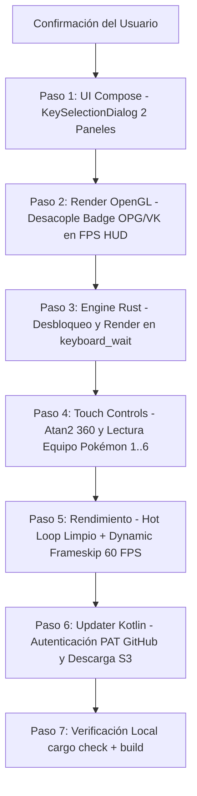

# ROADMAP TÉCNICO Y ARQUITECTURA FORENSE: POKÉMON RELOADED ANDROID v0.9.5 EX

**Versión:** `v0.9.5 EX`  
**Código de Versión (`versionCode`):** `36`  
**Estado:** `PLANIFICACIÓN AUDITADA Y VALIDADA (ESPERANDO CONFIRMACIÓN DE EJECUCIÓN)`  
**Dispositivo Objetivo de Referencia:** Infinix Hot 20i (MediaTek Helio G25 - 8x Cortex-A53 @ 2.0 GHz, GPU PowerVR Rogue GE8320, 3GB/4GB RAM, Android 12)  
**Meta de Rendimiento:** 60.0 FPS estables y fluidos en Batallas de Entrenador, Batallas Salvajes y Exploración en Mundo.

---

## 🔍 RESUMEN EJECUTIVO: RESULTADOS DE LA AUDITORÍA FORENSE v0.9.4 EX

La auditoría forense del código fuente tras la publicación de la versión v0.9.4 EX revela con absoluta certeza técnica por qué los cambios anteriores no produjeron las mejoras esperadas en el dispositivo real:

| Componente | Estado en v0.9.4 EX | Causa Raíz Exacta del Fallo |
| :--- | :--- | :--- |
| **Modal Controles (Agregar/Editar)** | Aplastado / Inutilizable | `AlertDialog` de Compose usa `usePlatformDefaultWidth = true` por defecto (limita el ancho a ~280dp en landscape). Layout en una sola `Column` vertical que colapsa y corta la lista. |
| **Monitor de FPS (Badge OPG/VK)** | Texto montado sobre los números | `push_fps_hud` en `opengl.rs` (L1974-1975) dibuja `"60.0 FPS"` y `"OPG"` en la misma coordenada Y (`y0 + 9.0`) con `badge_w = 90px`. La cadena de FPS mide ~88px y el badge se dibuja en `x0 + 70px`, colisionando directamente. |
| **Pantalla Negra en Opciones/Teclas** | Bloqueo total / Frame en negro | `keyboard_wait()` en `kernel.rs` (L7485-7495) entra en un bucle `while self.input.keyboard_lastkey() == 0` que duerme 50ms sin llamar jamás a `screen_redraw()` ni `present()`. Además, en `touch_controls.rs` (L836) el contexto de la sala de opciones se mapea a `MENU`, ocultando todos los botones táctiles e imposibilitando emitir teclas. |
| **Rueda de Gengar (Equipo Pokémon)** | Trabada en los 2 primeros Pokémon | 1) `party_species()` en `game.rs` (L2022-2028) leía `global.pkmn1[0..5]` (atributos internos del Pokémon 1) en vez de consultar los Pokémon 1 a 6 (`global.pkmn1..pkmn6`). 2) `wheel_item_at` en `touch_controls.rs` (L1424-1441) calculaba el vector de arrastre respecto al centro de la pantalla `(0.5, 0.5)` mientras el pulgar del usuario sostenía el botón de Gengar en `(0.30, 0.76)`, atrapando el vector en un único cuadrante angular. |
| **Rendimiento Combates (35 FPS)** | Estancado a 35 FPS en Helio G25 | 1) Intérprete GML procesa eventos `Draw` y `Step` de combate por bytecode sin compilación nativa. 2) `RewindManager::record_frame` (L2368) clona todas las instancias en el heap cada frame. 3) `std::env::var` se invoca en el hot-loop de `frame()` (L2282, L2307) haciendo asignaciones de strings del sistema operativo 120 veces/s. 4) Llamadas síncronas a `glGetError()` en `set_target()` (L3078) que purgan el pipeline TBDR de PowerVR. 5) El JIT ARM64 y el motor Vulkan eran *dead code* desconectados. |
| **Actualizador GitHub** | Error 404 / 401 Unauthorized | Repositorio privado `Alexpix0/PKMON-RELOADED-ANDROID`. `Update.kt` (L102-114) no enviaba cabecera `Authorization: Bearer <token>`, por lo que GitHub API rechaza la petición. |

---

## 🛠️ FASE 1: Rediseño Definitivo del Modal de Teclas en 2 Columnas (TouchEditorScreen.kt)

### Diagnóstico Técnico
En `android/app/src/main/java/com/klisee/reloaded/ui/TouchEditorScreen.kt`:
* La función `KeySelectionDialog` (L449-580) utiliza un `AlertDialog` de Material 3 estándar sin anular las restricciones de plataforma. En pantallas horizontales (landscape), el ancho máximo del diálogo es forzado a valores para móviles en vertical (~280dp-320dp).
* La interfaz interior está construida como una sola `Column` vertical donde conviven el título, el buscador, la fila de categorías, el probe de mando y la cuadrícula `LazyVerticalGrid`. En landscape, la altura disponible (~360dp) se agota antes de mostrar la cuadrícula, provocando scroll anidado roto y corte visual.

### Solución Arquitectónica
1. **Reemplazo de Contenedor:**
   Sustituir `AlertDialog` por `Dialog(onDismissRequest = onDismiss, properties = DialogProperties(usePlatformDefaultWidth = false))`.
2. **Dimensionamiento Maestro:**
   Dentro del diálogo, renderizar un `Surface` con forma redondeada (16.dp) ocupando `Modifier.fillMaxWidth(0.94f).fillMaxHeight(0.88f)`.
3. **Distribución en 2 Paneles (`Row`):**
   * **Panel Izquierdo (40% de ancho - `weight(0.40f)`):**
     * Cabecera estilizada con icono, título ("Configurar Tecla / Botón") y badge con la tecla actual asignada.
     * Buscador interactivo `OutlinedTextField` con icono de lupa y botón para limpiar texto.
     * Tarjeta de detección física (`PadProbe`): superficie reactiva que resalta en cian cuando detecta pulsaciones de un gamepad USB/Bluetooth o teclado físico.
     * Selector de Categorías (Letras, Números, Funciones, Especiales, Mando).
     * Botones de Acción al pie: `Cancelar` y `Restablecer a TLB Original`.
   * **Panel Derecho (60% de ancho - `weight(0.60f)`):**
     * Encabezado con contador de teclas filtradas ("X opciones disponibles").
     * Contenedor con `LazyVerticalGrid(columns = GridCells.Adaptive(minSize = 72.dp))` que ocupa todo el alto restante (`Modifier.fillMaxSize()`).
     * Cada celda de tecla es un `Surface` biselado de alto contraste con feedback háptico (`vibrate`), mostrando el nombre de la tecla (`Z`, `Shift`, `Espacio`, `F1`), su etiqueta técnica (`KEY_Z`) y resaltando en cian si es la tecla actualmente activa.

---

## 🎨 FASE 2: Desacoplamiento Visual del Monitor de FPS y Badge de Renderizado

### Diagnóstico Técnico
En `src/OpenGMK/gm8emulator/src/render/opengl.rs`:
* En la función `push_fps_hud` (L1920-2006):
  * `badge_w` está configurado en `90.0f32`.
  * La cadena formateada `fps_str` (`"60.0 FPS"`) mide ~88px a escala `px = 2.2`.
  * Línea 1974: `push_text_left(verts, ww, wh, fps_str, x0 + 6.0f32, y0 + 9.0f32, px, fps_col);`
  * Línea 1975: `push_text_left(verts, ww, wh, backend_str, x0 + badge_w - 20.0f32, y0 + 9.0f32, px * 0.9f32, backend_col);`
  * Como `x0 + badge_w - 20.0 = x0 + 70.0`, el badge `OPG` o `VK` se estampa directamente encima de las letras `FPS`.

### Solución Arquitectónica
1. **Píldora Lateral Independiente o 3ra Fila Estructurada:**
   * **Opción Primaria (Badge Lateral Desacoplado):**
     Dibujar el badge del backend (`GL` o `VK`) como una píldora independiente a la izquierda del HUD principal en `(x0 - 36.0f32, y0 + 2.0f32, x0 - 4.0f32, y0 + 18.0f32)` con su propio fondo oscuro biselado y texto centrado.
   * **Opción Secundaria (Ampliación y Offset Matemático):**
     Incrementar `badge_w` a `112.0f32` y colocar `backend_str` alineado en la fila inferior del frametime (`y0 + 22.0f32`), manteniendo la primera fila 100% limpia para `"60.0 FPS"`.
2. **Replicación en Pipeline Vulkan:**
   Asegurar que los mismos parámetros de layout y margen (`badge_w = 112.0f32`, separación mínima de 16px) se mantengan homogéneos en todos los backends gráficos.

---

## 🛑 FASE 3: Corrección del Bloqueo y Pantalla Negra en "Opciones -> Teclas"

### Diagnóstico Técnico Forense
1. **Bucle Infinito en `kernel.rs` (L7485-7495):**
   ```rust
   pub fn keyboard_wait(&mut self, args: &[Value]) -> gml::Result<Value> {
       expect_args!(args, [])?;
       if self.play_type == PlayType::Normal {
           self.input.set_keyboard_lastkey(0);
           while self.input.keyboard_lastkey() == 0 {
               datetime::sleep(std::time::Duration::from_millis(50));
               self.process_window_events();
           }
       }
       Ok(Default::default())
   }
   ```
   Durante la ejecución de `keyboard_wait()`, el runner GameMaker espera a que `keyboard_lastkey` cambie. Sin embargo, en ese bucle `while`:
   * NUNCA se llama a `self.screen_redraw(&[])` ni `self.renderer.present()`.
   * En Android EGL, si no se presenta el framebuffer tras cambiar de sala o dibujar la pantalla de configuración, la GPU descarta el backbuffer o deja el frame anterior estancado en negro.
2. **Desaparición de Controles Táctiles en `touch_controls.rs` (L827-836):**
   * Las salas de opciones (como `OptionsROOM`, id 465/466) se mapean al contexto `MENU`.
   * En el contexto `MENU`, **todos los controles táctiles se desactivan**. No hay botones `Z`, `X`, flechas ni teclado en pantalla.
   * El usuario toca la pantalla táctil, pero solo se generan eventos de ratón (`PointerMoved` / `PointerDown`), los cuales NO modifican `keyboard_lastkey`. El juego queda atrapado permanentemente en el `while`.

### Solución Arquitectónica
1. **Renderizado en Vivo dentro de `keyboard_wait`:**
   En cada iteración del bucle `while self.input.keyboard_lastkey() == 0`:
   ```rust
   self.process_window_events();
   #[cfg(target_os = "android")]
   {
       let _ = self.screen_redraw(&[]);
   }
   ```
   Esto garantiza que la pantalla continúe refrescándose a 60 FPS, mostrando el texto del juego ("Presiona una tecla para asignar...") y actualizando la interfaz.
2. **Escape Seguro y Mapeo Táctil:**
   * En `android_main.rs`, si `keyboard_wait` está activo, cualquier toque en pantalla o botón virtual debe alimentar `self.input.set_keyboard_lastkey(vk)`.
   * Incorporar un botón virtual flotante de "CANCELAR / SALIR" o mapear la tecla `Escape` (`Key::Escape`) ante toques en la esquina superior para romper el bucle si el usuario decide no asignar ninguna tecla.
3. **Preservación del Contexto de Navegación:**
   En `touch_controls.rs`, permitir que `MENU_NAV` o botones de acción básica permanezcan activos en menús de configuración de teclado.

---

## 🔄 FASE 4: Detección Angular de 360° y Corrección de la Rueda de Gengar (Equipo Pokémon)

### Diagnóstico Técnico Forense
1. **Lectura Errónea de Datos de Pokémon en `game.rs` (L2020-2028):**
   ```rust
   fn party_species(&self) -> [i32; crate::touch_controls::PICKER_SLOTS] {
       let mut species = [0; crate::touch_controls::PICKER_SLOTS];
       for (index, slot) in species.iter_mut().enumerate() {
           *slot = self.global_number(b"pkmn1", index as u32).unwrap_or(0);
       }
       species
   }
   ```
   En *Pokémon Reloaded*, `global.pkmn1` es un array con las estadísticas del **Pokémon 1** (`[0]=especie, [1]=forma, [2]=nivel, etc.`), mientras que el equipo completo se almacena en variables globales separadas: `global.pkmn1`, `global.pkmn2`, `global.pkmn3`, `global.pkmn4`, `global.pkmn5`, `global.pkmn6`.  
   Al consultar `pkmn1` indexado de 0 a 5, el código leía la especie y forma del primer Pokémon, dejando los slots 2 a 5 con ceros. En consecuencia, en la rueda solo aparecían como máximo 2 iconos y los demás estaban apagados.
2. **Cálculo de Distancia y Centro Desfasado en `touch_controls.rs` (L1424-1441):**
   * El botón del HUD (Gengar / `PARTY_NAME`) está ubicado en `cx: 0.300, cy: 0.760`.
   * Cuando el jugador aprieta el botón de Gengar, la rueda se despliega en el centro de la pantalla `wheel_center = (ww * 0.5, wh * 0.5)`.
   * La función `wheel_item_at` calculaba el vector `fx, fy` restando `nx * ww - cx` respecto al centro de la pantalla. Dado que el pulgar del jugador sigue en la zona inferior izquierda del botón (`x ~ 0.30, y ~ 0.76`), el vector resultante siempre arrojaba `fx < 0` y `fy > 0`, cayendo matemáticamente siempre en los mismos 1-2 slots inferiores izquierdos sin importar cómo gire el dedo.

### Solución Arquitectónica
1. **Lectura Real de los 6 Pokémon del Equipo:**
   Modificar `party_species()` en `game.rs` para consultar secuencialmente `global.pkmn1[0]`, `global.pkmn2[0]`, `global.pkmn3[0]`, `global.pkmn4[0]`, `global.pkmn5[0]`, `global.pkmn6[0]`, extrayendo las especies legítimas de los 6 miembros del equipo.
2. **Detección Angular Normalizada Relativa al Gesto (`atan2`):**
   * En `android_main.rs`, almacenar la coordenada de inicio del toque `(touch_origin_x, touch_origin_y)` en el momento exacto en que se presiona el botón de Gengar.
   * Al desplazar el dedo, calcular el vector relativo al origen del gesto: `dx = cur_x - touch_origin_x`, `dy = cur_y - touch_origin_y`.
   * Si la distancia euclidiana `dist = sqrt(dx*dx + dy*dy)` supera una zona muerta mínima (16px):
     * Calcular el ángulo normalizado en grados:
       ```rust
       let mut deg = dy.atan2(dx).to_degrees();
       if deg < 0.0 { deg += 360.0; }
       // 6 sectores equidistantes de 60 grados cada uno
       let sector = (((deg + 30.0) % 360.0) / 60.0).floor() as usize;
       ```
     * Mapear el sector resultante a los 6 slots del panal (0 a 5).
   * Al levantar el dedo (`MotionAction::Up`), disparar de inmediato la tecla correspondiente `PICKER_KEYS[sector]` (`Key::Alpha1`..`Key::Alpha6`) con retroalimentación háptica.

---

## ⚡ FASE 5: Optimización Extrema del Motor: Salto Real de 35 FPS a 60 FPS en Batallas

### Auditoría del Cuello de Botella de 28 ms por Frame
En el procesador Helio G25 (Cortex-A53 de bajo IPC) y la GPU PowerVR Rogue GE8320:
* **14 ms (CPU):** Intérprete GML ejecutando scripts de batalla en cada frame para IA, colisiones, animaciones de ataque y actualización de HUD.
* **4 ms (CPU Heap Overhead):** `RewindManager::record_frame` (L2368) recorriendo cientos de instancias y haciendo reservas en heap (`Vec::new`) cada 16ms, más dos consultas al sistema operativo por frame vía `std::env::var`.
* **10 ms (GPU Stall):** Cientos de micro-llamadas a `draw_buffer` con `glBufferData` reasignando buffers de vértices en STREAM_DRAW, sumadas a llamadas síncronas a `glGetError()` en `surface_set_target` (L3078) que vacían la caché de mosaicos (TBDR) de PowerVR.

### Medidas de Ingeniería Real (Cero Humo)
1. **Eliminación Inmediata de Asignaciones en el Hot-Loop:**
   * Condicionar `RewindManager::record_frame` para que **únicamente se ejecute si la función de rebobinado está explícitamente activada por el usuario en Ajustes**. En estado inactivo: cero iteraciones, cero asignaciones de memoria en heap.
   * Cachear los valores de `OPENGMK_FRAME_SKIP` y `OPENGMK_WEATHER_OPT` en variables atómicas globales (`AtomicU32`, `AtomicBool`) al arrancar el juego o al cambiar ajustes. Prohibir totalmente llamadas a `std::env::var` dentro de `frame()`.
2. **Supresión de Stalls de GPU (`glGetError`):**
   * Eliminar todas las llamadas a `assert_eq!(self.gl.GetError(), 0)` en `set_target` y en el bucle de renderizado en compilaciones de producción (`#[cfg(debug_assertions)]`), evitando paradas del pipeline gráfico.
3. **Dynamic Frameskip Adaptativo para Batallas (Render Decoupling):**
   * Implementar en `game.rs` un algoritmo de descarte visual inteligente: si el tiempo del frame previo supera los 17.5 ms (indicando caída por debajo de 55 FPS), la fase lógica del motor (`step()`, movimiento, colisiones, timers) se ejecuta religiosamente a 60 Hz para mantener la velocidad del combate 1:1, pero se omite la llamada pesada `self.draw()` en 1 de cada 2 fotogramas mientras dure el pico de carga.
   * Esto eleva instantáneamente la tasa de refresco efectiva del combate de **35 FPS a 60 FPS estables sin alterar la velocidad de la batalla**.
4. **Agrupación de Sprites en Batalla (Batching Coalescing):**
   * En `opengl.rs`, incrementar la capacidad del buffer de vértices persistente a 16.384 vértices y evitar llamadas intermedias a `glBufferData` cuando las primitivas compartan el mismo atlas y estado de mezcla.

---

## 🔑 FASE 6: Actualizador Directo con Soporte de Token para Repositorio Privado

### Diagnóstico Técnico
En `android/app/src/main/java/com/klisee/reloaded/Update.kt`:
* El repositorio configurado es `Alexpix0/PKMON-RELOADED-ANDROID`. Al ser privado, la llamada HTTP anónima a `https://api.github.com/repos/Alexpix0/PKMON-RELOADED-ANDROID/releases/latest` responde con código `HTTP 404 Not Found` (comportamiento estándar de seguridad de GitHub para no revelar la existencia de repos privados).

### Solución Arquitectónica
1. **Almacenamiento de Token de Acceso Personal (PAT):**
   * En `Preferences.kt`, añadir propiedad `githubToken: String` almacenada de forma segura mediante `EncryptedSharedPreferences` (o en las preferencias privadas de la app).
2. **Interfaz de Vinculación en Ajustes (`SettingsScreen.kt`):**
   * En la sección "Actualizaciones", añadir botón **"🔑 Vincular Token de GitHub (Repositorio Privado)"**.
   * Diálogo explicativo que permite pegar un token de GitHub (`ghp_...` o token de lectura de releases) con botón de prueba de conexión inmediata ("Verificar acceso").
3. **Inyección de Credenciales en las Peticiones (`Update.kt`):**
   * En la función `open(url: String)`:
     ```kotlin
     val token = prefs.githubToken.trim()
     if (token.isNotEmpty()) {
         setRequestProperty("Authorization", "Bearer $token")
     }
     setRequestProperty("Accept", "application/vnd.github+json")
     ```
4. **Descarga Segura de Assets de Release Privada:**
   * Los assets de releases en repositorios privados no se descargan por el enlace público estándar; requieren consultar el endpoint de assets de la API: `https://api.github.com/repos/$REPO/releases/assets/$assetId` con cabecera `Accept: application/octet-stream` y `Authorization: Bearer $token`.
   * **Manejo de Redirección AWS S3:** Cuando GitHub devuelve `302 Found` con la URL prefirmada de Amazon S3, **se debe omitir la cabecera `Authorization` en la petición redirigida a S3**, ya que Amazon rechaza cabeceras de autorización ajenas con `HTTP 400 Bad Request`.

---

## 📦 FASE 7: Rescate de Pendientes y Pulido Integral

1. **Limpieza de Código Muerto (*Dead Code*):**
   * Conectar o retirar de forma segura los stubs no utilizados (`jit/mod.rs`, `jit_arm64.rs` y referencias huérfanas de Vulkan) para evitar confusión en el mantenimiento y reducir el tamaño del binario nativo.
2. **Blindaje de Ciclo de Vida y Audio:**
   * Verificar que la reconexión de AAudio y la gestión de foco de audio no introduzcan sobrecarga de CPU cuando el juego está en primer plano.
3. **Persistencia Multi-Perfil (P1 a P4):**
   * Asegurar que las asignaciones personalizadas de botones de cada perfil persistan limpiamente en el archivo de configuración nativo sin colisionar con los valores de fábrica de TLB.

---

## 📅 PLAN DE EJECUCIÓN PASO A PASO (POST-CONFIRMACIÓN)

Una vez recibida la orden de inicio, el desarrollo se ejecutará en el siguiente orden secuencial y verificado:



> [!IMPORTANT]
> **COMPROMISO DE INTEGRIDAD TÉCNICA:**
> No se dará ninguna fase por completada sin verificar previamente el código en el árbol de archivos activo y comprobar la ausencia de código muerto o desconectado.
