<div align="center">

# ⚡ Pokémon Reloaded EX — Edición Nativa Android

[](https://github.com/Alexpix0/PKMON-RELOADED-ANDROID/releases/latest)
[](https://github.com/Alexpix0/PKMON-RELOADED-ANDROID/actions)
[](https://github.com/Alexpix0/PKMON-RELOADED-ANDROID/releases)
[](https://www.rust-lang.org/)

**La experiencia definitiva y de alto rendimiento de Pokémon Reloaded adaptada a dispositivos móviles.**  
*Ejecución 100% nativa con aceleración por hardware, cero capas de emulación y controles táctiles adaptativos de ultra baja latencia.*

[Descargar Último APK (v1.0.3)](https://github.com/Alexpix0/PKMON-RELOADED-ANDROID/releases/latest) • [Reportar Incidencia](https://github.com/Alexpix0/PKMON-RELOADED-ANDROID/issues) • [Novedades](https://github.com/Alexpix0/PKMON-RELOADED-ANDROID/releases)

---

</div>

## 📖 Acerca del Proyecto

**Pokémon Reloaded EX** es una reimplementación nativa diseñada para ejecutar **Pokémon Reloaded** (The Last Beta) directamente sobre el hardware de tu dispositivo Android con la máxima fidelidad y rendimiento.

A diferencia de soluciones convencionales basadas en cajas de compatibilidad como Wine, emuladores de Windows o entornos x86 virtualizados que consumen batería y degradan la velocidad, esta edición ejecuta el juego mediante un runner nativo de **GameMaker 8 compilado en Rust (OpenGMK)** acoplado por JNI a una interfaz moderna construida en **Kotlin y Jetpack Compose**.

> [!IMPORTANT]
> **Filosofía de Integridad:** Este repositorio no contiene ni distribuye binarios propietarios, música ni assets gráficos del juego original. El usuario suministra su propia copia legítima en archivo `.zip`.

---

## 🚀 Innovaciones Técnicas de la Edición EX (Builds 40 y 41)

```mermaid
flowchart LR
    subgraph UI["📱 Interfaz de Usuario (Kotlin + Jetpack Compose)"]
        A1["Gestor de Partidas y Nube"]
        A2["HUD Táctil Adaptativo y Editor Dinámico"]
        A3["Panel de Ajustes Modular (QoL)"]
    end

    subgraph Bridge["⚡ Puente JNI de Ultra Baja Latencia"]
        B1["Paso de Texturas y Shaders"]
        B2["Canal Atómico de Entrada (0ms Lag)"]
    end

    subgraph Engine["⚙️ Motor Nativo Rust (OpenGMK)"]
        C1["Spatial Hash Grid (Colisiones O(1))"]
        C2["Afinidad Big.LITTLE (Pinning a Big Cores)"]
        C3["Pipeline Gráfico OpenGL ES 3.0 / Vulkan"]
        C4["AAudio Stream de Búfer Reducido"]
    end

    UI <===> Bridge <===> Engine
```



### ⚡ 1. Arquitectura de Alto Rendimiento
- **Cuadrícula Espacial (Spatial Hash Grid):** Optimización matemática de colisiones reduciendo la complejidad algorítmica de $O(N^2)$ a $O(1)$. Sincronización dual en cada ciclo de juego y pre-filtrado por cajas de colisión sólidas (`is_solid_rect`).
- **Afinidad de Hilos CPU (Big.LITTLE Pinning):** El hilo principal de simulación y renderizado se fija automáticamente a los núcleos de alto rendimiento (*Prime / Big Cores*) del SoC móvil (`sched_setaffinity`), garantizando estabilidad sin estrangulamiento térmico ni degradación a núcleos de bajo consumo.
- **Frameskip Inteligente Desacoplado:** Mantiene el 100% de la velocidad física de batalla y exploración incluso en situaciones de alta carga gráfica.
- **Tablas de Búsqueda Rápida (`fast_lut`):** Aceleración trigonométrica y vectorial precalculada para proyectiles, desplazamientos angulares y cálculos de daño.

### 🎮 2. Tasa de Refresco y Fluidez (60 / 120 FPS)
- **Nativo (30/60 FPS):** Respeta la cadencia y tiempo original programado para cada zona.
- **60 FPS Forzados:** Desbloqueo de velocidad de fotogramas para eliminar el límite de 30 FPS en mapas extensos.
- **120 FPS Interpolado:** Desacoplamiento gráfico mediante búfer *lock-free* SPSC diseñado para pantallas AMOLED y fluidas (90 Hz / 120 Hz / 144 Hz).

### 🕹️ 3. Controles Físicos y Táctiles Avanzados
- **Cruceta Octogonal (8-Way D-Pad):** Soporte de movimiento diagonal preciso a $45^\circ$ imprescindible para el sistema de combate en tiempo real.
- **HUD Dinámico y Editor Libre:** Personaliza la posición, escala y opacidad de cada botón. Perfiles independientes para Exploración, Combate, Diálogos y Menús.
- **Teclas Rápidas y Puzzles:** Botones contextuales ⟲ (Q) y ⟳ (E) para los rompecabezas de Ruinas Alfa / Omega, junto a accesos rápidos para Guardado Instantáneo (F5), Reloj (H) y Flauta (F).
- **Mando Físico Plug & Play:** Detección automática de mandos Bluetooth y USB (Xbox, PlayStation, Switch Pro, Razer Kishi, Gamesir).

---

## 📲 Instalación y Puesta en Marcha

1. **Instalar el APK:**  
   Descarga e instala la última versión desde la sección de [Releases](https://github.com/Alexpix0/PKMON-RELOADED-ANDROID/releases/latest).

2. **Obtener los datos del juego:**  
   Consigue el archivo `.zip` oficial de **Pokémon Reloaded (The Last Beta)** desde el [Blog Oficial de F3R](https://pokemon-reloaded.blogspot.com/).

3. **Importar y Jugar:**  
   Abre la app, pulsa en **Importar Juego** y selecciona el `.zip`. El juego se configurará automáticamente en el almacenamiento protegido del dispositivo.

---

## 🛠️ Compilación desde el Código Fuente

### Requisitos Previos
- **Android NDK:** r26b o superior
- **Rust Toolchain:** 1.77+ con targets `aarch64-linux-android` y `armv7-linux-androideabi`
- **Herramientas:** `cargo-ndk`, JDK 17, Android SDK Platform 34

### Pasos de Construcción

```bash
# 1. Clonar el repositorio con submódulos
git clone https://github.com/Alexpix0/PKMON-RELOADED-ANDROID.git
cd PKMON-RELOADED-ANDROID

# 2. Compilar el motor nativo en Rust (librerías .so)
cd src/OpenGMK
cargo ndk -t arm64-v8a -t armeabi-v7a -o ../../android/app/src/main/jniLibs build -p gm8emulator --release
cd ../..

# 3. Compilar el APK de Android
cd android
./gradlew assembleRelease
```

El ejecutable firmado resultante se generará en `android/app/build/outputs/apk/release/app-release.apk`.

---

## 🤝 Créditos y Agradecimientos

- **Pokémon Reloaded:** Desarrollado magistralmente por **F3R** y colaboradores ([Blog Oficial](https://pokemon-reloaded.blogspot.com/)).
- **OpenGMK:** Reimplementación de código abierto del motor GameMaker 8 ([GitHub](https://github.com/OpenGMK/OpenGMK)).
- **Mantenimiento y Arquitectura EX:** [Alexpix0 / Armando](https://github.com/Alexpix0/PKMON-RELOADED-ANDROID) y la comunidad de colaboradores.

---

<div align="center">

*Aviso Legal: Pokémon es una marca registrada de Nintendo, Game Freak y Creatures Inc. Este proyecto es una herramienta de emulación comunitaria de código abierto, sin fines de lucro y no está afiliado ni respaldado por ninguna de las entidades propietarias de la marca.*

</div>
